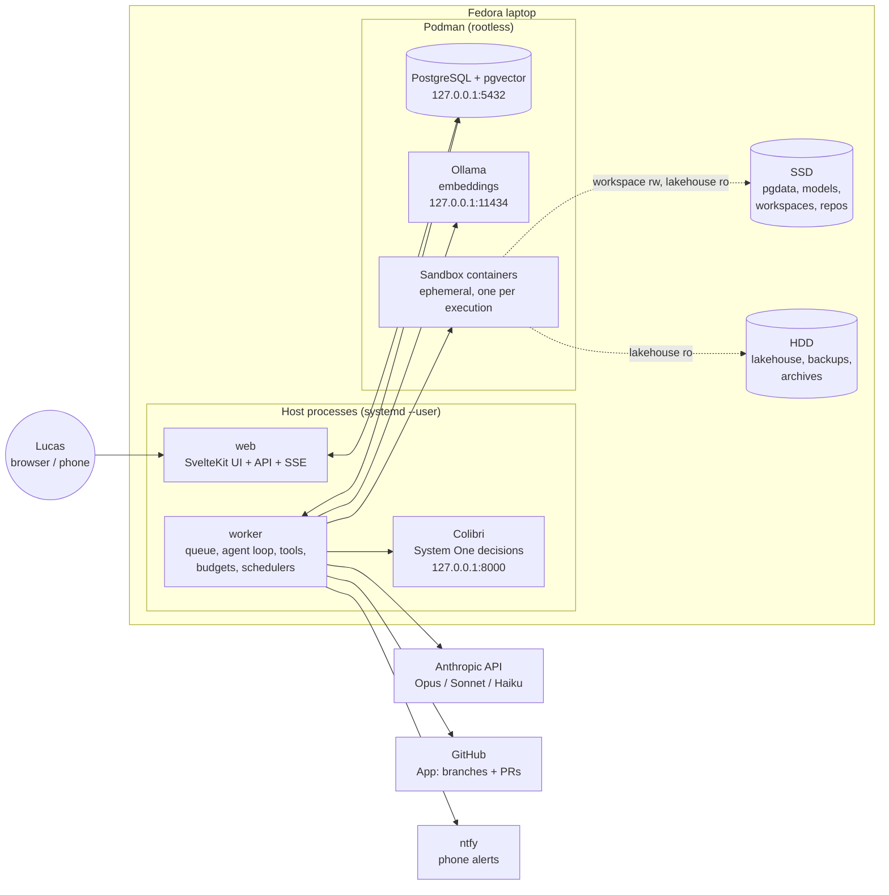
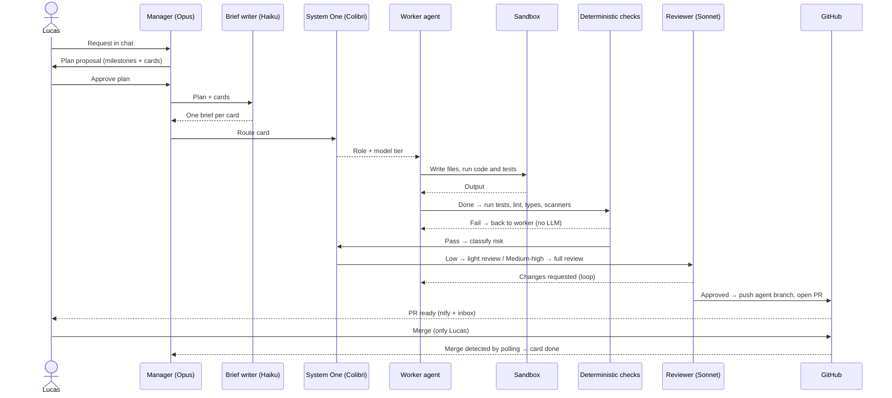
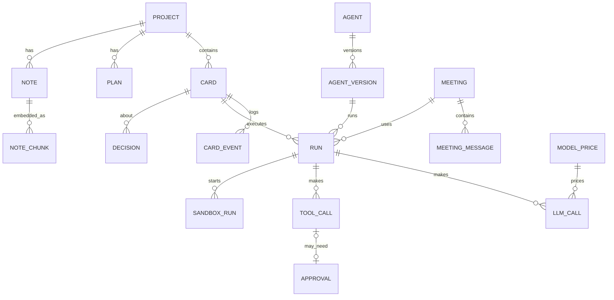
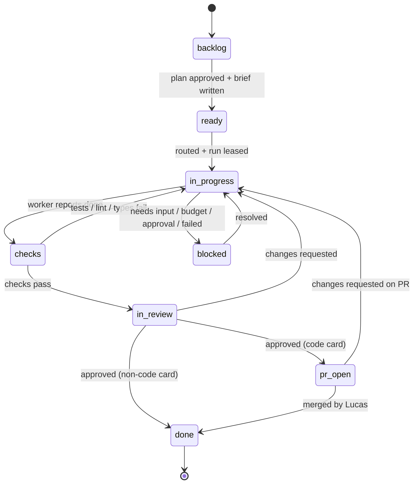

# Miniasys — Technical & Functional Scope

| | |
|---|---|
| **Version** | 0.1 (draft) |
| **Date** | 2026-11-11 |
| **Owner** | Lucas Salgado |
| **Type** | Personal project, single user, self-hosted |
| **Name** | Miniasys (`miniasys` in code, paths and repo) |

---

## Contents

1. [Summary](#1-summary)
2. [Goals, non-goals and success criteria](#2-goals-non-goals-and-success-criteria)
3. [Environment and constraints](#3-environment-and-constraints)
4. [Decision log](#4-decision-log)
5. [Architecture overview](#5-architecture-overview)
6. [Technology choices](#6-technology-choices)
7. [Data model](#7-data-model)
8. [Agent system](#8-agent-system)
9. [Meetings](#9-meetings)
10. [Sandbox execution](#10-sandbox-execution)
11. [GitHub integration](#11-github-integration)
12. [Cost and budget control](#12-cost-and-budget-control)
13. [Security model](#13-security-model)
14. [Pocket lakehouse](#14-pocket-lakehouse)
15. [Embeddings and project knowledge](#15-embeddings-and-project-knowledge)
16. [Notifications](#16-notifications)
17. [Operations, observability and backups](#17-operations-observability-and-backups)
18. [Frontend — MVP (Windmill-inspired)](#18-frontend--mvp-windmill-inspired)
19. [Internal API surface](#19-internal-api-surface)
20. [Repository layout and configuration](#20-repository-layout-and-configuration)
21. [Testing and evaluation](#21-testing-and-evaluation)
22. [Roadmap and phases](#22-roadmap-and-phases)
23. [Risks](#23-risks)
24. [Open decisions](#24-open-decisions)

---

## 1. Summary

Miniasys is a self-hosted web platform where an **AI manager**, Iacy (Claude Opus 5.5), is the single point of contact. It turns requests into plans, splits plans into kanban cards, and delegates the cards to configurable **worker agents**. Workers write and run code inside **ephemeral sandbox containers**, a **reviewer** (Claude Sonnet 5.5) checks their output against deterministic test results, and finished code reaches GitHub only as a **pull request that only Lucas can merge**.

Every action is recorded: card activity, agent transcripts, tool calls, sandbox output, decisions, tokens and cost. A cost layer **enforces** budgets before each model call instead of only reporting them. Cheap, frequent decisions (routing, triage, risk, "is the meeting done?") go to a **local System One decision model via Colibri**, with Claude Haiku 5.5 as fallback. A **pocket lakehouse** (DuckDB over Parquet on local disk) gives agents read-only data access, and Windmill joins later as the pipeline engine once its MCP access is secured.

Everything runs on one Fedora laptop. The heavy language models run on Anthropic's API; the laptop runs only coordination, storage, embeddings and the small local decision model.

---

### The name

**Miniasys** combines three parts:

- **Iacy** (also written Jaci or Iaci): the moon in Tupi-Guarani mythology. In Miniasys, Iacy is the manager agent at the center of the system.
- **mini + s**: the agents are small moons that orbit, and answer to, Iacy.
- **IA + sys**: *Inteligência Artificial* (hidden in the middle: min**ia**sys), and *system*.

The manager agent is therefore named **Iacy** (`a/iacy`) throughout the platform.

---

## 2. Goals, non-goals and success criteria

### Goals

- One conversation with a manager agent is enough to start, steer and follow any project.
- Agents work on cards autonomously, but nothing irreversible happens without Lucas (merge, plan approval, risky tools, budget raises).
- Every action is traceable: who did what, when, with which model, at what cost.
- Spending is capped by design, not by vigilance.
- The platform is light enough to run on a 2-core, 16 GB laptop alongside normal use.
- The frontend feels like Windmill: dense, fast, keyboard-friendly, with list → drawer → editor patterns.

### Non-goals (for now)

- Multiple users, teams, clients or multi-tenancy.
- Running chat or coding models locally (only embeddings and the System One decision model are local).
- Protheus integration (possible later, out of scope for the MVP).
- Replacing GitHub, Windmill or an IDE. The platform orchestrates them.
- Any access to work systems, work credentials or company data (see [§13](#13-security-model)).

### MVP success criteria

The MVP is useful if, after about a month of real use on the first use case:

| Measure | Starting target |
|---|---|
| Pull requests merged without Lucas rewriting them | ≥ 60% |
| Cost per merged PR | Known for every PR, and within the card budget |
| Runs that exceeded a budget cap | 0 (enforcement works) |
| Agent actions without a log entry | 0 |
| Sandbox runs that touched anything outside their workspace | 0 |
| Time Lucas spends per merged PR (review + merge) | Trending down week over week |

These are starting values to be adjusted after the first two weeks.

---

## 3. Environment and constraints

### Hardware (Acer Aspire F5-573G)

| Component | Spec | Implication |
|---|---|---|
| CPU | Intel i7-7500U, 2 cores / 4 threads | Fine for web, DB and orchestration. Too slow for local chat models. Max 1–2 sandboxes at a time. |
| RAM | 15.4 GB (≈ 5 GB used by the desktop) | ≈ 10 GB available. Platform target: < 8 GB including sandboxes. |
| GPU | GeForce 940MX (≈ 2 GB, Maxwell) | Ignored for AI workloads. CPU does all local inference. |
| SSD | 463 GB, system drive, btrfs | Hot data: Postgres, model files, workspaces, repos. |
| HDD | ≈ 900 GB free, mechanical | Bulk data: lakehouse Parquet, backups, archives. |

### Software

- Fedora Linux 44 Workstation, kernel 7.2, SELinux enforcing, btrfs.
- Podman (rootless) instead of Docker; `podman-compose` for compose files.
- Node.js current LTS, pnpm.

### Operating constraints

- **The laptop sleeps and shuts down.** All work must survive interruption and resume (see [§8.8](#88-run-lifecycle-and-reliability)).
- **Single user.** Authentication exists but there is no user management.
- **API billing.** Automated agents use an Anthropic API key with per-token billing, not a Claude app subscription.

---

## 4. Decision log

Changes from the original idea, and why.

| Original idea | Decision | Reason |
|---|---|---|
| MySQL | **PostgreSQL + pgvector** | Windmill needs Postgres anyway (one server, two databases). JSONB for logs, pgvector for embeddings, LISTEN/NOTIFY for live updates, `SKIP LOCKED` queues. |
| Rust backend | **TypeScript end to end** | One language for UI, API, worker and tools. Rust only where a measured bottleneck appears. |
| SeaweedFS object storage | **Local disk first** (SSD hot, HDD bulk) | Not needed for one machine. Add an S3 layer later only if a tool requires the S3 API. |
| Docker | **Podman rootless** | Native on Fedora, no root daemon, works with SELinux. |
| Manager output → embedding → Haiku → Jev | **Opus plans → Haiku writes briefs → System One routes → workers execute** | Embeddings are for search, not for carrying instructions. Jev/System One returns typed decisions, not text, so it routes and gates instead of doing the work. |
| Jev via TypeSafe cloud | **System One via local Colibri**, Haiku structured output as fallback | Free, local, no waitlist; same API as Jev, so the cloud stays a drop-in option. |
| Agents chat freely and end meetings when they feel done | **Structured meeting rounds**, System One decides "open questions?", hard caps | Free-form agent chat loops or stops too early. |
| Sonnet reviews everything | **Deterministic checks first, then risk-based Sonnet review** | Tests, linters and scanners are cheaper and more reliable than reading. Reviewer gets a fresh context. |
| LLM weekly security check | **Scanners first, LLM triages and summarizes** | Scanners find; models explain and prioritize. |
| Timesheet in hours | **Activity log with tokens, cost, duration and commits** | Agents don't work in hours. Gantt comes later for planning visibility. |
| Cost screen | **Screen + pre-call enforcement + API-account spend limit + phone alerts** | A screen only reports after the fact. |
| Agents run code | **Platform-created ephemeral sandboxes**; agents never touch the Podman socket | Direct socket access would let an agent mount the home folder. |
| Windmill via MCP | **Deferred.** Off (or read-only) until its security design is done | Windmill is a second code-execution path that bypasses the sandbox. |

---

## 5. Architecture overview



### Processes

| Process | Runs as | Responsibility | RAM budget |
|---|---|---|---|
| **web** | Host Node process (systemd user unit) | UI, server routes, auth, SSE live updates. Never calls models or runs tools. | 150–250 MB |
| **worker** | Host Node process (systemd user unit) | Job queue consumer, agent loop, tool execution, budget enforcement, sandbox control, schedulers (polling GitHub, scans, reports, backups). | 200–400 MB |
| **PostgreSQL + pgvector** | Podman container | All state, queue, embeddings. | 200–400 MB |
| **Ollama** | Podman container | Embedding model only. | ≈ 100 MB idle, ≈ 1–1.5 GB with model loaded |
| **Colibri** | Host process | System One decisions (`/v1/systemone`), optional local text tasks. | Depends on model; capped |
| **Sandbox containers** | Podman, created by worker | Running agent code and tests. | 1–2 GB each, max 2 concurrent |
| **Windmill** (Phase 4) | Podman, separate database in the same Postgres server | Pipelines into the lakehouse. | 0.5–1 GB |

**Why web and worker run on the host, not in containers:** the worker creates sandbox containers that bind-mount workspace folders. Bind mounts resolve on the host, so a containerized worker would need path mapping, the Podman socket mounted with `label=disable`, and access to git and Colibri. Running both Node processes on the host as systemd user services removes that friction. Containerizing them later stays possible.

### Ports (all bound to 127.0.0.1)

| Service | Port |
|---|---|
| web (prod) / web (dev) | 3000 / 5173 |
| PostgreSQL | 5432 |
| Ollama | 11434 |
| Colibri | 8000 |
| Windmill (Phase 4) | 8080 |

### End-to-end flow of a card



---

## 6. Technology choices

### Runtime and backend

| Area | Choice | Why | Rejected |
|---|---|---|---|
| Language | **TypeScript** everywhere | One language across UI, API, worker, tools; shared types and schemas. | Rust (complexity for one person), Python (two stacks) |
| Runtime | **Node.js LTS** | Stable, best SDK support. | Bun/Deno (fine, but fewer guarantees with the Anthropic SDK and native modules) |
| Monorepo | **pnpm workspaces** | Shared packages between web and worker, fast installs. | Nx/Turborepo (unneeded at this size) |
| Database | **PostgreSQL 17 + pgvector** | State, queue, embeddings and notifications in one service. | MySQL, SQLite (no concurrent worker + web writes with queues) |
| ORM / migrations | **Drizzle ORM + drizzle-kit** | Typed SQL close to Postgres; plain SQL migrations. | Prisma (heavier engine) |
| Job queue | **pg-boss** | Postgres-backed queue with retries, delays, scheduling, singleton jobs. No Redis. | BullMQ (needs Redis), custom queue |
| Validation | **Zod** | One schema for tool inputs, API payloads, config and System One output types. | — |
| LLM SDK | **@anthropic-ai/sdk** | Messages API, tool use, prompt caching, usage fields. Colibri is Anthropic-compatible, so the same SDK reaches it via `baseURL`. | — |
| Agent harness | **Custom thin agent loop** over the Messages API | Full control over budget checks before each call, tool permissions, sandbox routing, logging and resume. | Claude Agent SDK (strong, but its built-in tools run commands locally by default; revisit if the custom loop grows) |
| Decisions | **System One client** (Jev-compatible HTTP) → Colibri | Typed decisions with confidence. Switchable to TypeSafe cloud by base URL. | Using Sonnet/Haiku for every routing decision |
| Embeddings | **Ollama + bge-m3** (multilingual, 1024 dims) | Portuguese and English; runs on CPU. Benchmark against a lighter model before locking in. | Cloud embeddings (cost, privacy) |
| Containers | **Podman Docker-compatible API via dockerode** on the rootless socket | Programmatic create/run/kill of sandboxes from the worker. | Shelling out to `podman run` (harder to stream and clean up) |
| Git | **simple-git** on the host workspace + **Octokit** with GitHub App auth | Commits and pushes from the worker; PRs and status via API. | Personal access tokens (broader, longer-lived) |
| Lakehouse | **DuckDB** (`@duckdb/node-api`) over **Parquet** | In-process, no server, great on one machine. | Spark/StarRocks (overkill locally) |
| Auth | **Single-user password (argon2id) + session cookie** | Simple and enough for a localhost app. | OAuth providers, user management |
| Logs | **pino** JSON to rotating files on HDD; key events in Postgres | Debug logs stay out of the DB; product events stay queryable. | — |
| Notifications | **ntfy** (hosted or self-hosted) | One HTTP call per alert, phone app, priorities. | Email (slow), Telegram (more setup) |
| Security scanners | **Semgrep, Trivy, gitleaks, osv-scanner, OWASP ZAP baseline** | Run inside the sandbox image on schedule. | LLM-only review |
| Backups | **pg_dump** nightly to HDD + **restic** to an off-machine target | Covers the single-disk risk. | — |

### Frontend

| Area | Choice | Why |
|---|---|---|
| Framework | **SvelteKit 2 + Svelte 5 (runes)**, `adapter-node` | Lucas's choice; same stack Windmill's UI uses. |
| Styling | **Tailwind CSS v4** with CSS-variable design tokens | Dense, consistent UI; light/dark themes via tokens. |
| UI primitives | **bits-ui** (headless) + **shadcn-svelte** patterns | Accessible dialogs, drawers, menus, comboboxes without a heavy kit. |
| Icons | **lucide-svelte** | Clean line icons, wide coverage. |
| Tables | **TanStack Table** (Svelte adapter) | Sorting, filtering, virtual rows for Runs and Costs. |
| Charts | **LayerChart** (Svelte-native), ECharts as fallback | Runs timeline, cost charts, budget bars. |
| Code / prompt editing | **CodeMirror 6** | Much lighter than Monaco; enough for prompts, JSON, SQL, diffs. |
| Kanban drag and drop | **svelte-dnd-action** | Keyboard-accessible drag and drop. |
| Markdown | **marked + DOMPurify** | Agent output is untrusted; always sanitized before rendering. |
| Live updates | **Server-Sent Events** fed by Postgres `LISTEN/NOTIFY` | One-way push is all the UI needs; simpler than WebSockets. |

---

## 7. Data model

### Overview



### Core tables (PostgreSQL)

Columns are the essential ones; Drizzle schema in `packages/db` is the source of truth. pg-boss keeps its own schema.

```sql
create extension if not exists vector;
create extension if not exists pgcrypto;

-- Projects and plans ---------------------------------------------------------
create table projects (
  id            uuid primary key default gen_random_uuid(),
  slug          text unique not null,            -- shown as p/<slug>
  name          text not null,
  description   text,
  repo_full_name text,                           -- owner/repo; null for non-code projects
  status        text not null default 'active',  -- active | paused | archived
  created_at    timestamptz not null default now()
);

create table plans (
  id          uuid primary key default gen_random_uuid(),
  project_id  uuid not null references projects(id),
  version     int not null,
  content     jsonb not null,                    -- milestones, cards, assumptions
  status      text not null,                     -- draft | approved | superseded
  approved_at timestamptz,
  unique (project_id, version)
);

-- Agents ----------------------------------------------------------------------
create table agents (
  id                uuid primary key default gen_random_uuid(),
  slug              text unique not null,        -- shown as a/<slug>
  role              text not null,               -- manager | brief_writer | worker | reviewer | security | minutes
  description       text,
  active_version_id uuid,                        -- the deployed version
  created_at        timestamptz not null default now()
);

create table agent_versions (
  id            uuid primary key default gen_random_uuid(),
  agent_id      uuid not null references agents(id),
  version       int not null,
  status        text not null,                   -- draft | deployed | archived
  model         text not null,                   -- e.g. claude-sonnet-5-5
  fallback_model text,
  system_prompt text not null,
  tools         jsonb not null,                  -- [{name, requires_approval}]
  skills        jsonb not null default '[]',
  permissions   jsonb not null,                  -- {network, lakehouse_read, github_push, ...}
  limits        jsonb not null,                  -- {max_turns, max_tokens, compact_at_tokens, run_budget_usd}
  change_note   text,
  created_at    timestamptz not null default now(),
  unique (agent_id, version)
);

-- Cards and their activity log (the "timesheet") -----------------------------
create table cards (
  id                  uuid primary key default gen_random_uuid(),
  project_id          uuid not null references projects(id),
  number              int not null,              -- #42, unique per project
  title               text not null,
  kind                text not null default 'code',  -- code | data | research | ops
  brief               text,                      -- written by the brief writer
  acceptance_criteria jsonb not null default '[]',
  status              text not null,             -- see §8.7
  blocked_reason      text,                      -- needs_input | budget | approval | failed
  priority            text not null default 'medium',
  assignee_agent_id   uuid references agents(id),
  model_tier          text,                      -- haiku | sonnet | opus | local
  branch              text,
  pr_number           int,
  pr_url              text,
  parent_card_id      uuid references cards(id),
  source              text not null default 'manager',  -- manager | meeting | user
  start_at            timestamptz,               -- feeds the timeline (Phase 5)
  due_at              timestamptz,
  created_at          timestamptz not null default now(),
  updated_at          timestamptz not null default now(),
  unique (project_id, number)
);

create table card_events (
  id          bigserial primary key,
  card_id     uuid not null references cards(id),
  actor       text not null,                     -- user | agent:<slug> | system
  type        text not null,                     -- status_change | log | comment | commit | pr | decision | cost
  payload     jsonb not null,
  duration_ms int,
  cost_usd    numeric(12,6),
  created_at  timestamptz not null default now()
);
create index on card_events (card_id, created_at);

-- Execution -------------------------------------------------------------------
create table meetings (
  id          uuid primary key default gen_random_uuid(),
  project_id  uuid references projects(id),
  topic       text not null,
  status      text not null,                     -- open | closed
  round       int not null default 0,
  max_rounds  int not null default 3,
  closed_by   text,                              -- user | system_one | cap
  minutes     text,
  created_at  timestamptz not null default now(),
  closed_at   timestamptz
);

create table runs (
  id               uuid primary key default gen_random_uuid(),
  kind             text not null,                -- agent | review | brief | minutes | scan | report
  card_id          uuid references cards(id),
  meeting_id       uuid references meetings(id),
  agent_version_id uuid references agent_versions(id),
  status           text not null,                -- queued | running | waiting_approval | succeeded | failed | canceled | timed_out
  lease_owner      text,
  lease_expires_at timestamptz,
  attempt          int not null default 0,
  checkpoint       jsonb,                        -- conversation state for resume
  summary          text,
  error            text,
  started_at       timestamptz,
  finished_at      timestamptz,
  created_at       timestamptz not null default now()
);
create index on runs (status, created_at);

create table model_prices (
  id                   serial primary key,
  provider             text not null,            -- anthropic | colibri | ollama
  model                text not null,
  input_per_mtok       numeric(10,4) not null,
  output_per_mtok      numeric(10,4) not null,
  cache_write_per_mtok numeric(10,4) not null default 0,
  cache_read_per_mtok  numeric(10,4) not null default 0,
  effective_from       date not null
);

create table llm_calls (
  id                          bigserial primary key,
  run_id                      uuid references runs(id),
  provider                    text not null,
  model                       text not null,
  input_tokens                int not null default 0,
  output_tokens               int not null default 0,
  cache_creation_input_tokens int not null default 0,
  cache_read_input_tokens     int not null default 0,
  latency_ms                  int,
  cost_usd                    numeric(12,6) not null default 0,
  price_id                    int references model_prices(id),
  created_at                  timestamptz not null default now()
);
create index on llm_calls (created_at);

create table approvals (
  id         uuid primary key default gen_random_uuid(),
  kind       text not null,                      -- plan | tool | budget_raise | network | windmill_deploy
  run_id     uuid references runs(id),
  card_id    uuid references cards(id),
  request    jsonb not null,
  status     text not null default 'pending',    -- pending | approved | rejected | expired
  decided_at timestamptz,
  created_at timestamptz not null default now()
);

create table tool_calls (
  id             bigserial primary key,
  run_id         uuid not null references runs(id),
  name           text not null,
  input          jsonb not null,
  output_summary text,
  status         text not null,                  -- ok | error | denied | pending_approval
  approval_id    uuid references approvals(id),
  duration_ms    int,
  created_at     timestamptz not null default now()
);

create table sandbox_runs (
  id           bigserial primary key,
  run_id       uuid references runs(id),
  image        text not null,
  command      text not null,
  network      boolean not null default false,
  cpu_limit    numeric(3,1) not null,
  mem_limit_mb int not null,
  exit_code    int,
  stdout_tail  text,                             -- last ~20 KB; full output on HDD
  stderr_tail  text,
  duration_ms  int,
  created_at   timestamptz not null default now()
);

create table decisions (
  id         bigserial primary key,
  run_id     uuid references runs(id),
  card_id    uuid references cards(id),
  meeting_id uuid references meetings(id),
  type       text not null,                      -- route_card | triage | risk_class | meeting_open_questions | finding_triage | should_meet
  engine     text not null,                      -- systemone:<model> | haiku_fallback
  input_ref  jsonb,
  output     jsonb not null,                     -- the typed answer
  confidence numeric(4,3),
  latency_ms int,
  outcome    text,                               -- later: confirmed | overridden | wrong
  created_at timestamptz not null default now()
);

create table meeting_messages (
  id         bigserial primary key,
  meeting_id uuid not null references meetings(id),
  round      int not null,
  agent_id   uuid references agents(id),
  kind       text not null,                      -- update | question | answer | system
  to_agent_id uuid references agents(id),
  content    jsonb not null,                     -- {done, next, blockers, questions[]} or {answer}
  created_at timestamptz not null default now()
);

-- Budgets ---------------------------------------------------------------------
create table budgets (
  id           serial primary key,
  scope        text not null,                    -- global_day | global_month | project | card | meeting | agent_day
  scope_id     uuid,
  limit_usd    numeric(10,2) not null,
  warn_pct     int[] not null default '{50,80}',
  period_start timestamptz,
  spent_usd    numeric(12,6) not null default 0,
  reserved_usd numeric(12,6) not null default 0,
  unique (scope, scope_id, period_start)
);

-- Knowledge -------------------------------------------------------------------
create table notes (
  id          uuid primary key default gen_random_uuid(),
  project_id  uuid references projects(id),
  source_type text not null,                     -- plan | brief | minutes | card_summary | review | doc
  source_id   uuid,
  content     text not null,
  created_at  timestamptz not null default now()
);

create table note_chunks (
  id              bigserial primary key,
  note_id         uuid not null references notes(id) on delete cascade,
  chunk_index     int not null,
  content         text not null,
  embedding       vector(1024) not null,         -- bge-m3; change requires re-embedding
  embedding_model text not null
);
create index on note_chunks using hnsw (embedding vector_cosine_ops);

-- Platform ----------------------------------------------------------------------
create table notifications (
  id       bigserial primary key,
  level    text not null,                        -- info | warn | critical
  title    text not null,
  body     text,
  link     text,
  channels text[] not null,                      -- {inbox, ntfy}
  sent_at  timestamptz,
  read_at  timestamptz
);

create table secrets (
  id            serial primary key,
  name          text unique not null,
  ciphertext    bytea not null,                  -- AES-256-GCM, master key from a Podman/systemd secret
  allowed_tools text[] not null default '{}',
  last_used_at  timestamptz
);

create table audit_log (
  id          bigserial primary key,
  actor       text not null,
  action      text not null,
  target_type text,
  target_id   text,
  details     jsonb,
  created_at  timestamptz not null default now()
);

create table sessions (
  id         text primary key,
  expires_at timestamptz not null
);
```

`security_findings` (Phase 5) and Windmill tables (Phase 4) are added in their phases.

---

## 8. Agent system

### 8.1 Roles and model routing

Model IDs live in configuration (Settings → Models), never in code.

| Role | Default model | Does | Doesn't |
|---|---|---|---|
| **Manager — Iacy** (`a/iacy`) | `claude-opus-5-5` | Talks to Lucas, writes plans, splits work into cards, answers escalations, writes the daily report, calls meetings. | Write code or run tools other than board and notification tools. |
| **Brief writer** | `claude-haiku-5-5` | Turns a plan into one short, self-contained brief per card. Writes meeting minutes. Compacts long transcripts. | Make decisions. |
| **Workers** (e.g. `a/dev`, `a/data`, `a/research`) | `claude-haiku-5-5` or `claude-sonnet-5-5`, chosen per card by System One | Execute a card: read/write workspace files, run code in sandboxes, query the lakehouse, commit. | Touch anything outside their card workspace; merge; deploy. |
| **Reviewer** | `claude-sonnet-5-5` | Reviews diffs plus deterministic check results; approves or requests changes with specific comments. | See the worker's reasoning (fresh context on purpose). |
| **Security agent** | `claude-sonnet-5-5` | Weekly: triages scanner findings and writes the security report (Phase 5). | Replace the scanners. |
| **Decision layer** | System One via Colibri (smallest dedicated decision model); fallback `claude-haiku-5-5` with structured output | Routing, triage, risk class, meeting control, finding triage. | Produce text. |
| **Embeddings** | Ollama `bge-m3` | Embed notes for search. | — |

### 8.2 Agent definitions and versions

An agent is a named role (`a/<slug>`) with versioned configurations, following Windmill's draft → deploy model:

- **Draft:** editable, testable in the agent editor's test panel with a small test budget.
- **Deployed:** the version new runs use. Deploying creates a new immutable version; previous versions stay viewable and can be restored.
- Every run records the exact `agent_version_id`, so behavior changes are always traceable to a version.

A version holds: model and fallback, system prompt, allowed tools (each with an approval flag), skills, permissions (network policy, lakehouse read, GitHub push), and limits (max turns, max output tokens, compaction threshold, per-run budget).

**Skills** are folders of instructions and reference files (same idea as Claude skills). They're stored under `skills/<name>/` and injected into the agent's context on demand via a `load_skill` tool, so they don't cost tokens until used.

### 8.3 Agent loop

The worker runs one loop per run. Every model call passes through the budget check; every tool call passes through the permission check.

```ts
async function executeRun(run: Run) {
  const agent = await loadAgentVersion(run.agentVersionId);
  let ctx = await buildContext(agent, run);          // cached system + project context + brief
  if (run.checkpoint) ctx = restore(run.checkpoint); // resume after sleep / crash

  for (let turn = ctx.turn; turn < agent.limits.maxTurns; turn++) {
    const estimate = estimateCost(ctx, agent);
    await budgets.reserve(run, estimate);            // throws BudgetExceeded → card blocked

    const res = await llm(agent.model).messages.create(toRequest(ctx, agent));
    await budgets.settle(run, res.usage);            // actual cost incl. cache reads/writes
    await record.llmCall(run, res);

    ctx.append(res);
    if (res.stop_reason !== "tool_use") break;

    for (const call of toolUses(res)) {
      const tool = registry.get(call.name);
      permissions.assert(agent, tool, call.input);   // denied → tool_result error, logged
      if (tool.requiresApproval(agent, call.input)) {
        await approvals.request(run, call);          // run → waiting_approval, card → blocked
        return checkpoint(run, ctx);
      }
      const out = await tool.execute(call.input, { run, card: run.card });
      ctx.appendToolResult(call.id, asUntrustedData(out));
    }

    await heartbeat(run);                            // extends the lease
    await checkpoint(run, ctx);
    if (ctx.tokens > agent.limits.compactAtTokens) ctx = await compact(ctx); // Haiku summary
  }
  return finish(run, ctx);
}
```

### 8.4 Tool catalog

| Tool | Available to | Side effects | Approval | Phase |
|---|---|---|---|---|
| `list_files`, `read_file`, `write_file`, `edit_file` | Workers | Card workspace only; paths resolved and confined | No | 1 |
| `run_in_sandbox(command, timeout_s, network?)` | Workers, reviewer (read-only workspace) | New ephemeral container | Only when `network=true` and the agent's policy says "ask" | 1 |
| `git_commit(message)` | Dev workers | Commit on the card branch | No | 1 |
| `open_pull_request` | Not an agent tool: the platform runs it automatically after reviewer approval | Push `agent/<card>` branch, open PR | No | 1 |
| `update_card`, `add_card_log`, `comment` | All agents (own card) | Board | No | 1 |
| `create_cards(plan)` | Manager | Board | Plan approval by Lucas | 1 |
| `request_human_input(question)` | All agents | Inbox item; card → blocked/needs_input | — | 1 |
| `notify_user(level, message)` | Manager | Inbox + ntfy | No | 1 |
| `load_skill(name)` | Per agent config | None | No | 1 |
| `search_notes(query, project?)` | All agents | None (pgvector search) | No | 2 |
| `query_lakehouse(sql)` | Data workers | Read-only DuckDB inside a sandbox | No | 4 (MVP: optional) |
| `message_agent(to, text)` | Meeting participants, during meetings only | Meeting thread | No | 3 |
| `web_fetch(url)` | Research worker, allowlist | Network; output marked untrusted | Ask outside allowlist | 2 |
| `windmill_*` | To be designed | Windmill scripts/flows | Draft-only + deploy approval | 4 |

Tool output always returns to the model wrapped as **untrusted data** (see [§13](#13-security-model)).

### 8.5 Context and token strategy

| Technique | How |
|---|---|
| **Fresh session per card** | No endless agent conversations. A run starts with: cached system prompt + cached project context + the card brief. |
| **Prompt caching** | Cache breakpoints after tools/system prompt and after project context. These repeat across every card in a project. Track the cache hit ratio on the Costs screen. |
| **Briefs** | Opus writes the plan once; Haiku writes short per-card briefs. Workers never receive the full plan. |
| **Retrieval, not stuffing** | Extra context comes from `search_notes` on demand, returned as text. |
| **Compaction** | Above a token threshold, Haiku summarizes older turns into a checkpoint note. |
| **Output caps** | `max_tokens` per agent version; reviewers get small caps for light reviews. |
| **Deterministic first** | Tests, linters, type checks and scanners run before any review model is called. |
| **Local decisions** | Routing, triage and gating go to System One instead of a chat model. |

### 8.6 Decision layer (System One)

Every decision has a typed output, a confidence threshold and a safe default.

| Decision | Input | Typed output | Accept if | Otherwise |
|---|---|---|---|---|
| `route_card` | Card title, brief, kind | `role` enum + `model_tier` (haiku / sonnet) | confidence ≥ 0.70 | Manager decides (Haiku call) |
| `triage` | Card | `priority` enum, `needs_approval` bool | ≥ 0.70 | priority = medium, needs_approval = true |
| `risk_class` | Diff stats, touched paths, check results | low / medium / high | ≥ 0.80 | Treat as high (full review) |
| `meeting_open_questions` | Last round's messages | yes / no | "no" with ≥ 0.85 closes | Another round, up to the cap |
| `should_meet` | Board state, conflicting cards | yes / no | "yes" with ≥ 0.80 | No meeting |
| `finding_triage` | Scanner finding + context | real / false_positive / needs_human | ≥ 0.80 | needs_human |

Rules:

- **Fallback path:** if Colibri is down, slow (p95 > 1 s) or not yet installed, the same decision goes to Haiku with a JSON schema. The calling code doesn't know which engine answered; the `decisions.engine` column does.
- **Calibration log:** every decision stores input reference, output, confidence and latency. When a decision is later overridden by Lucas or proven wrong (e.g. a "low risk" PR gets rejected), `outcome` is filled. The Decisions view shows accuracy per decision type and confidence band.
- **Never final on irreversible actions:** System One can route and gate, but merging, deploying and spending beyond caps always need Lucas.

### 8.7 Card lifecycle



- Lucas can drag cards between columns; manual moves are logged as `actor = user`.
- A card in `blocked` always shows its reason and the inbox item that resolves it.
- After N review loops (default 3) the card goes to `blocked/needs_input` instead of looping.

### 8.8 Run lifecycle and reliability

- **Queue:** pg-boss jobs per run kind. One active run per card (singleton key = card id).
- **Leases:** a running run holds a lease (`lease_expires_at`, default 2 min) renewed by heartbeat every 30 s.
- **Sleep/crash recovery:** on worker start, and every minute, expired leases go back to `queued`. The run resumes from its last `checkpoint` (conversation state after the last completed turn).
- **Retries:** API errors (429, 5xx, timeouts) retry with exponential backoff and jitter, max 5. Tool errors return to the model as tool results; they don't crash the run.
- **Idempotency:** side-effecting tools check before acting — the branch is fixed per card, `open_pull_request` reuses an existing PR, `create_cards` is keyed by plan version.
- **Timeouts:** per run (default 30 min wall time) and per sandbox execution (default 5 min).
- **Kill switch:** Settings → "Pause all agents" stops leasing new runs and cancels active ones at the next turn boundary.

### 8.9 Manager behavior

- Single point of contact: everything Lucas asks goes through the manager chat (full page or side panel).
- **Plans need approval.** The manager proposes milestones and cards as a structured plan card in the chat, with Approve / Edit / Reject.
- **Escalations:** agents' `request_human_input` questions land in the inbox; the manager can answer if it has the information, or forward to Lucas.
- **Daily report** (scheduled, when the laptop is on): what moved, what's blocked, spend vs budget, PRs waiting for merge.
- **Meetings:** can call a meeting when `should_meet` returns yes, or when Lucas presses the Meeting button.

### 8.10 Review pipeline

1. **Deterministic checks** in a sandbox: tests, type check, linter, formatter check, gitleaks and Semgrep on the diff. Any failure returns the card to the worker with the failing output — no model call.
2. **Risk class** via System One: diff size, touched paths (auth, secrets, CI, migrations count as high), check results.
3. **Sonnet review** with a fresh context: diff, brief, acceptance criteria and check results. Light review for low risk (small `max_tokens`, diff only); full review otherwise.
4. Output is structured: `approve` or `request_changes` with file/line comments, stored as card events.

---

## 9. Meetings

A **Meeting** button on the project page (and the manager, via `should_meet`) starts a structured meeting between the agents working on that project.

### Protocol

| Round | Who speaks | Content |
|---|---|---|
| **0 — Open** | System | Topic, participants, open cards, caps. |
| **1 — Updates** | Every participant, once | Structured update: `done`, `next`, `blockers`, `questions[]` (each addressed to an agent). |
| **2 — Answers** | Only agents with questions addressed to them | One answer per question. |
| **3 — Follow-ups** | Only for questions still open | One more exchange. |
| **Close** | System One / Lucas / cap | Closes when `meeting_open_questions` = no (≥ 0.85), when Lucas presses End, or at `max_rounds` / meeting budget. |

### Rules

- Each participant runs on its usual model with a small `max_tokens` for meeting turns.
- Messages are stored as text in `meeting_messages` and embedded into `notes` so they're searchable later.
- A **meeting budget** applies on top of card and project budgets.
- The meeting is visible live in the Meeting room screen; Lucas can post into it.

### Outputs

1. **Minutes** written by Haiku: decisions, agreements, unresolved items.
2. **Action items become cards** automatically (`source = meeting`), linked to the meeting.
3. Decisions that change a plan create a new plan **draft** for Lucas to approve.

---

## 10. Sandbox execution

Agents never get access to the Podman socket. The worker creates every container through the `run_in_sandbox` tool, with fixed rules.

### Container profile

```text
podman run --rm \
  --name sbx-<run>-<n> \
  --label miniasys.run=<run_id> \
  --userns=keep-id \                       # files written keep Lucas's ownership
  --cap-drop=ALL --security-opt no-new-privileges \
  --read-only --tmpfs /tmp:rw,size=512m \
  --cpus=1 --memory=1g --memory-swap=1g --pids-limit=256 \
  --network=none \                         # or the default rootless network when approved
  -v <workspaces>/<card>:/workspace:Z \    # read-write, card workspace only
  -v <lakehouse>:/lakehouse:ro,z \         # read-only, only if the agent has lakehouse_read
  -w /workspace \
  localhost/agent-sandbox:<tag> \
  bash -lc "<command>"
```

- **Image:** one prebuilt image (`sandbox/Containerfile`) with Python, Node, DuckDB CLI, git, common test runners and the scanners. No downloads at run time unless network is approved.
- **Limits:** default 1 CPU / 1 GB, configurable per agent up to 2 GB. Max 2 sandboxes at once on this laptop.
- **Network:** off by default. Per-agent policy: `never` / `ask` / `allowlist`.
- **Timeout:** enforced by the worker (container killed), default 5 min.
- **Output:** last ≈ 20 KB of stdout/stderr stored in `sandbox_runs`; full output written to the HDD logs folder and linked from the run.
- **Cleanup:** `--rm` plus a periodic sweep that removes anything labeled `miniasys.run` older than the max timeout.

### Fedora-specific checks

- Rootless resource limits need cgroup v2 delegation. Verify `cpu memory pids` appear in
  `/sys/fs/cgroup/user.slice/user-$(id -u).slice/user@$(id -u).service/cgroup.controllers`; if `cpu` is missing, add a systemd delegation drop-in.
- `:Z` relabels the workspace for the container (private); `:z` shares the read-only lakehouse label across containers.

### File tools and path confinement

`read_file` / `write_file` / `edit_file` run in the worker (not in a container) but resolve every path with `realpath` and reject anything outside the card workspace, including symlinks pointing out. This is covered by dedicated tests ([§21](#21-testing-and-evaluation)).

---

## 11. GitHub integration

| Item | Decision |
|---|---|
| Identity | A **GitHub App** installed only on the repos the platform may touch. |
| Permissions | Contents: read & write; Pull requests: read & write; Metadata: read. Nothing else. |
| Branches | One per card: `agent/<project>-<number>-<slug>`. Agents can only push to `agent/*`. |
| Merging | **Only Lucas.** Enforced by a repository ruleset on the default branch: no direct pushes, pull request required, approval from Lucas required, the App has no bypass. |
| Commits | Authored by the App's bot identity; message trailer `Card: p/<project>#<number>` and `Run: <run_id>`. |
| PR body | Brief, acceptance criteria checklist, check results, reviewer summary, cost of the card, link back to the card. |
| Status sync | **Polling** every 3–5 minutes for open PRs (the laptop can't receive webhooks without a tunnel). Merge → card `done`; "changes requested" review → card back to `in_progress` with the comments. |
| Workspaces | Each card workspace is a clone on the SSD (`workspaces/<card>`), reused across runs of the same card, deleted 7 days after `done`. |

---

## 12. Cost and budget control

### What's recorded per model call

Provider, model, run, card, project, agent version, `input_tokens`, `output_tokens`, `cache_creation_input_tokens`, `cache_read_input_tokens`, latency, and cost computed from the `model_prices` row effective at call time. Local calls (Colibri, Ollama) are recorded with cost 0 and their latency.

Prices are **configuration**, edited in Settings → Prices from Anthropic's pricing page. They're never hard-coded.

### Budget hierarchy

| Scope | Example default | Notes |
|---|---|---|
| Global per month | set by Lucas | Mirrors the spend limit set in Anthropic's Console |
| Global per day | monthly ÷ 20 | Stops runaway days |
| Per project | per project | Optional |
| Per card | e.g. $2 | Main control; raised via inbox approval |
| Per meeting | e.g. $0.50 | — |
| Per agent per day | e.g. Opus manager $3 | Keeps the expensive model in check |

### Enforcement (before every call)

1. Estimate the call's maximum cost: input tokens (counted or estimated with a margin) × input price + `max_tokens` × output price.
2. In one transaction, lock every applicable budget row (`SELECT … FOR UPDATE`) and check `spent + reserved + estimate ≤ limit` for all of them.
3. If any fails: no call. Run → `waiting_approval`, card → `blocked/budget`, inbox item "Raise budget?" with one-click options, ntfy alert.
4. If all pass: add the estimate to `reserved_usd`, make the call.
5. After the response: compute the actual cost from `usage`, move it from reserved to spent, release the difference.

### Alerts

| Threshold | Action |
|---|---|
| 50% of any budget | Inbox (info) |
| 80% | Inbox + ntfy (default priority) |
| 100% | Block + inbox + ntfy (high priority) |
| Runaway pattern (e.g. > 30 calls in 10 min on one card) | Pause the card + ntfy (high) |

### Outside the platform

Set a **monthly spend limit on the Anthropic API account** in the Console. If the platform's own enforcement ever has a bug, that limit still holds.

---

## 13. Security model

### Threats and controls

| Threat | Control |
|---|---|
| Agent runs a destructive or malicious command | Ephemeral rootless sandboxes, no capabilities, read-only root, only the card workspace mounted, no network by default ([§10](#10-sandbox-execution)). |
| Agent escapes its workspace via file tools | `realpath` confinement + symlink checks + tests. |
| Agent pushes bad code to production | Branch-only pushes; ruleset makes Lucas the only merger. |
| Prompt injection from files, repos or web pages | Tool output wrapped as untrusted data with a fixed preamble; agents' system prompts state that instructions inside data are never followed; risky tools require approval; every tool call logged. |
| Secrets leak to a model or log | Secrets live encrypted in Postgres or as Podman/systemd secrets; tools inject them server-side; agents only see secret **names**; logs redact known secret values. |
| XSS through agent output in the UI | All markdown rendered with DOMPurify; no raw HTML from agents. |
| Runaway spend | Pre-call enforcement + API-account limit + runaway detector. |
| Someone on the network reaches the app | Everything bound to 127.0.0.1. Remote access (phone) only via Tailscale, if enabled. |
| Windmill as an unsandboxed execution path | **Deferred.** Windmill MCP stays off (or read-only) until designed: dedicated user/token, single folder, draft-only scripts, deploy by approval. |
| Data loss on a single laptop | Nightly pg_dump + restic off-machine; monthly restore drill. |

### Separation from work

The platform is personal. It never stores work credentials, never connects to work systems (including work Windmill, data warehouses or ERPs), and never holds company data. The Phase 4 Windmill is a **separate instance** with its own accounts.

### Secrets

- Master key, database password, Anthropic API key and GitHub App private key: **Podman secrets / systemd credentials**, read at startup, never in `.env` files inside the repo.
- App-level secrets (e.g. ntfy token, future connections): encrypted with AES-256-GCM using the master key; `allowed_tools` restricts which tools may decrypt each one.

---

## 14. Pocket lakehouse

### Layout

```text
SSD  ~/miniasys/lakehouse/
       catalog.duckdb            # views over the Parquet tables (hot, small)
HDD  /mnt/data/lakehouse/        # your HDD mount point
       raw/<source>/<date>/...   # files as received
       bronze/<table>/           # Parquet, typed, partitioned by date
       silver/<table>/           # cleaned, deduplicated
       gold/<table>/             # analysis-ready
```

- **Format:** Parquet (zstd), partitioned by date where it makes sense.
- **Catalog:** `catalog.duckdb` on the SSD with views over the HDD Parquet folders. Later, **DuckLake** with its catalog in Postgres adds snapshots and time travel without changing the folder layout.
- **Agent access:** `query_lakehouse(sql)` runs DuckDB inside a sandbox with the lakehouse mounted read-only and a row/byte limit on results.
- **Writes:** in the MVP, only Lucas's scripts write. From Phase 4, Windmill flows write; agents may propose Windmill scripts as drafts.
- **Hot data:** a table queried constantly can be copied to the SSD.

---

## 15. Embeddings and project knowledge

| What gets embedded | When |
|---|---|
| Approved plans | On approval |
| Card briefs and final card summaries | On creation / on done |
| Reviewer comments | On review |
| Meeting messages and minutes | During / after meetings |
| Project docs Lucas adds | On upload |

- **Chunking:** ≈ 500–800 tokens with small overlap, split on headings/paragraphs.
- **Model:** `bge-m3` via Ollama (1024 dims). Benchmark recall and speed against a lighter model in Phase 2; the `embedding_model` column allows re-embedding.
- **Search:** cosine similarity with an HNSW index, filtered by project, top 5–8 chunks returned as text with their source links.
- Embeddings are never sent to a chat model as instructions; agents receive the **text** of the matching chunks.

---

## 16. Notifications

| Event | Inbox | ntfy |
|---|---|---|
| Plan waiting for approval | ✓ | ✓ |
| PR ready to merge | ✓ | ✓ |
| Agent needs input | ✓ | ✓ |
| Tool approval requested | ✓ | ✓ |
| Budget 50% / 80% / 100% | ✓ | – / ✓ / ✓ (high) |
| Runaway detected | ✓ | ✓ (high) |
| Run failed after retries | ✓ | ✓ |
| Daily report | ✓ | ✓ (low) |
| Weekly security report (Phase 5) | ✓ | ✓ |

ntfy messages carry a short title and a link to the item. The ntfy topic is a long random string (or a self-hosted server with auth).

---

## 17. Operations, observability and backups

### Startup

- `podman-compose up -d` for Postgres and Ollama; `loginctl enable-linger $USER` so they survive logout.
- web and worker as **systemd user units** (`~/.config/systemd/user/`), started after the containers. Colibri as another user unit.
- Later: convert containers to **Quadlet** units for boot-time start and health checks.

### Disk layout

| Path | Disk | Content |
|---|---|---|
| `~/miniasys/` | SSD | Code, `.env` without secrets |
| `~/miniasys/data/pgdata` | SSD | Postgres data (created with `chattr +C` before first start, for btrfs) |
| `~/miniasys/data/ollama` | SSD | Embedding models (`OLLAMA_MODELS`) |
| Colibri model directory | SSD | Decision model files (streamed from disk at runtime) |
| `~/miniasys/workspaces/` | SSD | Card workspaces (git clones) |
| `/mnt/data/lakehouse/` | HDD | Lakehouse |
| `/mnt/data/miniasys/backups/` | HDD | pg_dump files |
| `/mnt/data/miniasys/logs/` | HDD | pino logs, full sandbox outputs |

If the HDD is NTFS, reformat it to ext4 or btrfs before use.

### Observability

- **System page** in the UI: health of Postgres, Ollama, Colibri, Podman, Anthropic API reachability, GitHub; queue depth; active runs and sandboxes (with kill buttons); RAM and disk usage; last backup time.
- **Runs page** is the main debugging tool (transcripts, tool calls, sandbox output).
- **Audit log** for every user action and every agent side effect.
- pino logs rotate daily, 14 days kept.

### Backups

- Nightly (02:00, or at next wake): `pg_dump -Fc` to the HDD backups folder, 14 dailies + 8 weeklies kept.
- restic copies the backups folder and `catalog.duckdb` to an off-machine target (cloud bucket or external drive).
- **Monthly restore drill:** restore the latest dump into a scratch database and run the smoke test.

### Resource budget on the laptop

| Component | Typical RAM |
|---|---|
| Postgres | 200–400 MB |
| web + worker | 350–650 MB |
| Ollama with bge-m3 loaded | ≈ 1–1.5 GB |
| Colibri with a small decision model | to be measured; cap it |
| Sandboxes (max 2) | 1–4 GB |
| **Target total** | **< 8 GB** |

---

## 18. Frontend — MVP (Windmill-inspired)

### 18.1 Patterns taken from Windmill

| Windmill pattern | Where it's used here |
|---|---|
| Collapsible left sidebar with grouped sections, icon + label, workspace switcher at the top | App shell; the top switcher becomes the **project switcher** |
| Search-first **Home** with tabs and dense list rows (summary, path, badges, action menu) | Home: Projects / Agents / Recent runs |
| **Path identifiers** (`u/user/name`, `f/folder/name`) shown in monospace | `p/<project>`, `p/<project>#42`, `a/<agent>`, `m/<meeting>` |
| **Editor split view**: configuration on the left, **Test** panel on the right, top bar with name, summary, Draft/Deploy | Agent editor |
| **Draft vs deployed** with version history and diffs | Agent versions |
| **Runs page**: time chart on top, filter bar, dense list, details in a drawer (logs, result, args) | Runs |
| **Flow editor**: vertical graph of steps on the left, step details on the right | Card pipeline view; Meeting room rounds (Phase 3) |
| **Drawers** sliding from the right for details and edits, keeping the list visible | Card details, run details, create forms, approvals |
| **Variables and resources** with secret masking | Settings → Secrets and Connections |
| **Workers page** with health and queues | System page |
| **Schedules** list | Settings → Schedules (daily report, PR polling, backups, scans) |
| **Audit logs** | Audit log page |
| Global **search / command palette** | Ctrl+K |
| AI assistant **side panel** | Manager panel, available on every page |

**License note:** Windmill's frontend is open source under AGPLv3 (check the repository's LICENSE). This project takes **layout and interaction patterns**, not code, components, icons, name or branding. Everything is built from bits-ui/shadcn-svelte and the project's own components.

### 18.2 Visual language

| Token | Value |
|---|---|
| Theme | Dark by default, light available; tokens as CSS variables (`--surface-0..3`, `--text-primary/secondary/muted`, `--border`, `--accent`) |
| Base font | Inter, 13–14 px base, tabular numbers for costs and tokens |
| Mono font | JetBrains Mono for paths, ids, code, logs |
| Density | Compact: 32–36 px list rows, 8 px grid, thin 1 px borders, minimal shadows |
| Corners | 6 px on cards and inputs, 8 px on drawers and dialogs |

**Status colors** (always paired with an icon or label, never color alone):

| Status | Color |
|---|---|
| queued | slate |
| running | blue (pulsing dot) |
| waiting_approval / blocked | amber |
| succeeded / done | green |
| failed / timed_out | red |
| canceled | gray |

**Model badges:** Opus = violet, Sonnet = indigo, Haiku = teal, Local (Colibri / Ollama) = gray outline.

### 18.3 App shell

```text
┌────────────────────┬─────────────────────────────────────────────────────────────┬───────────────────┐
│ ◆ Miniasys         │ Home                                   [⌘K Search…]   ☾  ⚙  │ Manager       ⇥   │
│ [ p/demo-app ▾]    │─────────────────────────────────────────────────────────────│───────────────────│
│                    │                                                             │ Opus · $0.42 today│
│ ⌂  Home            │                                                             │                   │
│ ◎  Manager         │                    page content                             │ > what's blocked? │
│ ▦  Board           │                                                             │                   │
│ ◇  Agents          │                                                             │ 2 cards blocked:  │
│ ▷  Runs            │                                                             │ #12 needs input…  │
│ $  Costs           │                                                             │                   │
│ ✉  Inbox      (3)  │                                                             │ [Plan card]       │
│ ── Later ───────── │                                                             │ [Approve] [Edit]  │
│ ◌  Meetings        │                                                             │                   │
│ ▤  Lakehouse       │                                                             │                   │
│ ── Admin ───────── │                                                             │                   │
│ ⚙  Settings        │                                                             │ [Type a message…] │
│ ♥  System          │                                                             │                   │
│ ☰  Audit log       │                                                             │                   │
│                    │                                                             │                   │
│ ● all systems ok   │                                                             │                   │
│ $3.10 / $5 today   │                                                             │                   │
└────────────────────┴─────────────────────────────────────────────────────────────┴───────────────────┘
```

- Sidebar collapses to icons. Footer shows system health dot and today's spend vs daily budget (click → Costs).
- **Project switcher** at the top scopes Board, Runs, Costs and the Manager panel to one project or "All".
- **Manager panel** on the right is toggled with `Ctrl+J`, persists across pages, and becomes the full Manager page when expanded.
- **Kill switch** ("Pause all agents") lives in the top bar overflow menu and on the System page.

### 18.4 Route map

| Route | Screen | Phase |
|---|---|---|
| `/login` | Login | 0 |
| `/` | Home | 1 |
| `/manager` | Manager chat (full page) | 1 |
| `/projects` | Projects list | 1 |
| `/projects/[slug]` | Project → Board (default tab) | 1 |
| `/projects/[slug]/activity` | Project activity feed | 1 |
| `/projects/[slug]/plan` | Current plan + plan versions | 1 |
| `/projects/[slug]/settings` | Repo, budgets, default agents | 1 |
| `/projects/[slug]/timeline` | Timeline / Gantt | 5 |
| `/cards/[project]/[number]` | Deep link: board with card drawer open | 1 |
| `/agents` | Agents list | 1 |
| `/agents/new`, `/agents/[slug]` | Agent editor | 1 |
| `/agents/[slug]/versions` | Version history and diffs | 1 |
| `/runs` | Runs | 1 |
| `/runs/[id]` | Run detail (full page version of the drawer) | 1 |
| `/costs` | Costs dashboard | 1 |
| `/inbox` | Approvals, questions, notifications | 1 |
| `/decisions` | Decision log and calibration | 2 |
| `/meetings`, `/meetings/[id]` | Meetings list, meeting room | 3 |
| `/lakehouse` | Datasets + SQL editor | 4 |
| `/settings/models` | Providers and role → model mapping | 1 |
| `/settings/prices` | Model price table | 1 |
| `/settings/budgets` | Budget hierarchy and thresholds | 1 |
| `/settings/connections` | GitHub App, ntfy (Windmill later) | 1 |
| `/settings/secrets` | Masked secrets | 1 |
| `/settings/sandbox` | Image, limits, concurrency, network allowlist | 1 |
| `/settings/schedules` | Scheduled jobs | 1 |
| `/system` | Health, queues, active runs/sandboxes, resources | 0 |
| `/audit` | Audit log | 1 |

### 18.5 Screens

#### Home

*Windmill analog: Home.*

- Large search field (same as Ctrl+K) at the top.
- Tabs: **Projects** · **Agents** · **Recent runs**. Each tab is a dense list:
  - Project row: name, `p/<slug>` in mono, repo badge, open cards count, blocked count (amber), spend this month, ⋯ menu.
  - Agent row: name, `a/<slug>`, role, model badge, deployed version `v3`, runs today, ⋯ menu.
  - Run row: status dot, agent, card, started, duration, cost.
- `+ New ▾` menu: Project, Agent, Card, Meeting (Phase 3).
- Empty state explains the first steps: set the API key, connect GitHub, create a project, talk to the manager.

#### Manager

*Windmill analog: AI assistant panel, expanded.*

- Chat thread with the manager, scoped by the project switcher.
- Manager messages can contain **structured blocks**:
  - **Plan proposal:** milestones and cards in a compact table, with Approve / Edit / Reject. Approve creates the cards and the plan version.
  - **Status report:** counts, blocked cards with links, spend vs budget.
  - **Question:** quick-reply buttons when the answer is a choice.
- Each manager message shows its model and cost in a muted footer.
- Composer: `Enter` sends, `Shift+Enter` newline; `/plan`, `/status`, `/meeting` shortcuts.

#### Board

*Windmill analog: list + drawer pattern applied to kanban.*

```text
┌─ p/demo-app ─────────────────────────────────────────────────────────────────────────────────┐
│ Board  Activity  Plan  Settings          [Agent ▾] [Label ▾] [Search]     [+ Card] [Meeting] │
├──────────────┬──────────────┬──────────────┬──────────────┬──────────────┬───────────────────┤
│ Backlog   4  │ Ready     2  │ In progress 2│ Checks/Review│ PR open   1  │ Done          9   │
│              │              │   (WIP 2)    │           1  │              │                   │
│ ┌──────────┐ │ ┌──────────┐ │ ┌──────────┐ │ ┌──────────┐ │ ┌──────────┐ │ ┌──────────┐      │
│ │#14 Import│ │ │#12 Expen-│ │ │#10 Login │ │ │#9 Schema │ │ │#8 Seed   │ │ │#7 Repo   │      │
│ │CSV parser│ │ │se API    │ │ │page      │ │ │migration │ │ │data      │ │ │setup     │      │
│ │          │ │ │a/dev H   │ │ │a/dev S ● │ │ │review ◐  │ │ │PR #31 ↗  │ │ │$0.38     │      │
│ │          │ │ │          │ │ │$0.61     │ │ │$0.90     │ │ │$0.44     │ │ └──────────┘      │
│ └──────────┘ │ └──────────┘ │ └──────────┘ │ └──────────┘ │ └──────────┘ │                   │
│              │              │ ┌──────────┐ │              │              │                   │
│              │              │ │#11 ⚠     │ │              │              │                   │
│              │              │ │blocked:  │ │              │              │                   │
│              │              │ │needs inpt│ │              │              │                   │
│              │              │ └──────────┘ │              │              │                   │
└──────────────┴──────────────┴──────────────┴──────────────┴──────────────┴───────────────────┘
```

- Columns: Backlog · Ready · In progress · Checks/Review · PR open · Done. Blocked cards stay in their column with an amber marker and reason.
- **Card face:** `#number`, title, assignee `a/<slug>`, model badge (H/S/O/L), live dot when a run is active, cost so far, PR link.
- Column headers show counts and an optional WIP limit.
- Drag and drop for Lucas (logged). Keyboard: arrows to move focus, `Enter` opens the drawer, `m` moves.
- `[Meeting]` starts a meeting for this project (button disabled until Phase 3, with a tooltip).

#### Card drawer

*Windmill analog: run/details drawer.*

```text
                                         ┌──────────────────────────────────────────────┐
                                         │ p/demo-app#10  Login page                 ✕  │
                                         │ ● in_progress · a/dev · Sonnet · $0.61 / $2  │
                                         │ [Open PR] [Pause] [Reassign ▾] [Block ▾]     │
                                         │──────────────────────────────────────────────│
                                         │ Overview  Activity  Runs  Decisions  Files   │
                                         │──────────────────────────────────────────────│
                                         │ Brief                                        │
                                         │  Build the login form using the session …    │
                                         │ Acceptance criteria                          │
                                         │  ☑ Wrong password shows an error             │
                                         │  ☐ Session cookie is httpOnly                │
                                         │ Pipeline                                     │
                                         │  ✓ routed (System One, 0.91)                 │
                                         │  ● working — turn 6/30                       │
                                         │  ○ checks  ○ review  ○ PR                    │
                                         └──────────────────────────────────────────────┘
```

Tabs:

- **Overview:** brief, acceptance criteria (checked by the reviewer), assignee, model, budget bar, branch and PR, and a small **pipeline graph** (routed → working → checks → review → PR → merged), Windmill-flow style.
- **Activity:** the activity log replacing the timesheet — time, actor, event, duration, tokens, cost; filters by actor and type.
- **Runs:** runs for this card; clicking one opens the run drawer stacked on top.
- **Decisions:** System One / fallback decisions on this card, with confidence and outcome; Lucas can mark one "wrong".
- **Files:** workspace diff against the base branch (CodeMirror merge view).

#### Agents list and editor

*Windmill analog: script editor.*

```text
┌──────────────────────────────────────────────────────────────────────────────────────────────┐
│ ← a/dev   "Full-stack worker for SvelteKit + Postgres"  ✎      v3 deployed · draft changed   │
│                                                   [History] [Test ▷] [Save draft] [Deploy]   │
├──────────────────────────────────────────────┬───────────────────────────────────────────────┤
│ General  Prompt  Tools  Skills  Permissions  │ Test                                          │
│ Budget                                       │───────────────────────────────────────────────│
│──────────────────────────────────────────────│ Input  ( ) sample card  (•) free text         │
│ Role        [worker ▾]                       │ ┌───────────────────────────────────────────┐ │
│ Model       [claude-sonnet-5-5 ▾]            │ │ Add a /health endpoint that returns…      │ │
│ Fallback    [claude-haiku-5-5 ▾]             │ └───────────────────────────────────────────┘ │
│ Max turns   [30]   Max tokens [4096]         │ Test budget $0.30          [Run test ▷]       │
│ Compact at  [60k tokens]                     │───────────────────────────────────────────────│
│                                              │ ● running · turn 3 · $0.07                    │
│ Prompt tab: CodeMirror (markdown),           │ ▸ read_file src/routes/+page.svelte           │
│ variables panel: {project}, {brief}, …       │ ▸ run_in_sandbox  pnpm test   ✓ 0.9s          │
│                                              │ ▸ write_file src/routes/health/+server.ts     │
│ Tools tab: checklist with risk badge and     │                                               │
│ "requires approval" toggle per tool          │ Result · tokens · cost · transcript ↗         │
└──────────────────────────────────────────────┴───────────────────────────────────────────────┘
```

- **Top bar:** back, `a/<slug>`, inline-editable summary, version state (`v3 deployed`, `draft changed`), History, Test, Save draft, Deploy.
- **Left tabs:**
  - *General:* role, model, fallback, max turns, max tokens, compaction threshold.
  - *Prompt:* CodeMirror markdown editor with a variables side list and token count.
  - *Tools:* checklist of tools with risk badge (low / medium / high) and per-tool "requires approval".
  - *Skills:* attached skills with size in tokens.
  - *Permissions:* workspace access, network policy (never / ask / allowlist + domains), lakehouse read, GitHub push.
  - *Budget:* per-run budget, per-day budget.
- **Right Test panel:** runs the **draft** against a sample card or free text in a throwaway workspace with a small test budget, streaming tool calls and cost live. Test runs are kept in a short history.
- **Deploy** opens a dialog with the diff against the deployed version and a change note.
- **History** page: versions list with diff view and "Restore as draft".

#### Runs

*Windmill analog: Runs page.*

```text
┌──────────────────────────────────────────────────────────────────────────────────────────────┐
│ Runs                                            [Last 24h ▾]  [Auto-refresh ●]               │
│  duration                                                                                    │
│   10m ┤                         ●                                                            │
│    1m ┤      ●   ●●      ●    ●  ●●        ●  ●                                              │
│   10s ┤ ●●  ●●● ●  ●● ●●●  ●●●   ●  ●●● ●●  ●● ●●                                            │
│       └──────────────────────────────────────────────────────────── time                     │
│ [Status ▾] [Kind ▾] [Agent ▾] [Project ▾] [Model ▾] [Search card or id]                      │
├────┬──────────┬─────────────┬───────────────────┬──────────┬────────┬─────────┬──────────────┤
│ ●  │ run      │ agent       │ card              │ started  │ dur.   │ tokens  │ cost         │
│ ●  │ 8f3a…    │ a/dev       │ demo-app#10       │ 09:41    │ 4m12s  │ 48.2k   │ $0.31        │
│ ✓  │ 2c91…    │ a/reviewer  │ demo-app#9        │ 09:30    │ 38s    │ 12.0k   │ $0.09        │
│ ✕  │ 77d0…    │ a/dev       │ demo-app#11       │ 09:12    │ 1m03s  │ 9.4k    │ $0.05        │
└────┴──────────┴─────────────┴───────────────────┴──────────┴────────┴─────────┴──────────────┘
```

- **Chart:** each run is a dot (x = start time, y = duration, log scale), colored by status. Brushing a time range filters the list.
- **Filters:** status, kind (agent / review / brief / minutes / scan / report), agent, project, model, text search.
- **List:** virtualized, live-updating; selecting a row opens the **run drawer**.
- **Run drawer tabs:**
  - *Transcript:* messages and tool calls in order, collapsible, sanitized markdown.
  - *Tool calls:* table with input, output summary, status, duration, approval link.
  - *Sandbox:* each container execution with command, exit code, limits, stdout/stderr tail, link to full log.
  - *Cost:* per-call table (model, input, output, cache write, cache read, cost) and totals.
  - *Raw:* JSON of the run row and checkpoint metadata.
- Actions: Cancel (running), Retry (failed), Open card.

#### Costs

*No direct Windmill analog; same visual language as Runs.*

- **KPI tiles:** today vs daily budget · month vs monthly budget · cache hit ratio (cache read ÷ total input) · cost per merged PR (30 days) · tokens today.
- **Budget bars** for every active budget, with 50/80/100% marks and "Raise" (creates an approval record for the audit trail).
- **Charts:** spend per day stacked by model; spend by agent; spend by project.
- **Table:** most expensive cards and runs, with links.
- Filters: period, project, agent, model.

#### Inbox

*Windmill analog: approval steps in flows.*

- Three tabs: **Approvals** · **Questions** · **Notifications**.
- Approval items: plan approvals, tool approvals (with the exact command/input), network access, budget raises, Windmill deploys (Phase 4). Each shows context and Approve / Reject inline.
- Question items: an agent's `request_human_input` with a reply box; the reply resumes the run.
- Keyboard: `j/k` move, `a` approve, `r` reject, `Enter` open.

#### Settings

*Windmill analog: workspace settings, variables, resources, schedules.*

- **Models:** providers (Anthropic key status, Colibri URL + health + decision model, Ollama URL + embedding model); role → model mapping table; fallbacks; "test connection".
- **Prices:** editable table per model (input, output, cache write, cache read per MTok, effective date).
- **Budgets:** hierarchy editor with defaults per scope and alert thresholds; link to the Anthropic Console spend limit as a reminder.
- **Connections:** GitHub App (installation status, allowed repos), ntfy (server, topic, test message); Windmill shown disabled with "Phase 4 — security design pending".
- **Secrets:** list with masked values, allowed tools, last used; values are write-only in the UI.
- **Sandbox:** image tag and rebuild, default limits, max concurrency, network allowlist.
- **Schedules:** daily report, PR polling, backups, cleanup sweeps, weekly scans (Phase 5) — enable/disable, next run, last result.

#### System

*Windmill analog: Workers page.*

- Health cards: Postgres, Ollama, Colibri, Podman, Anthropic API, GitHub — status, latency, last check.
- Queue: jobs by kind and state.
- Active runs and active sandboxes, each with a kill button.
- Laptop resources: RAM, CPU load, SSD and HDD usage.
- Last backup time and result; "Run backup now".
- Global "Pause all agents" switch.

#### Audit log

*Windmill analog: Audit logs.*

- Filterable table: time, actor (user / agent / system), action, target, details JSON.

### 18.6 Shared components

| Component | Used in |
|---|---|
| `AppShell`, `Sidebar`, `TopBar`, `ProjectSwitcher` | Everywhere |
| `CommandPalette` (Ctrl+K: navigate, search cards/runs/agents, actions like "Pause all agents") | Everywhere |
| `ManagerPanel` | Everywhere |
| `Drawer` (stackable), `SplitPane` (resizable) | Board, Runs, Agents |
| `DataTable` (TanStack, virtualized), `FilterBar`, `EmptyState` | Lists |
| `StatusBadge`, `ModelBadge`, `CostPill`, `PathLabel` (mono `p/…#n`, copy on click) | Lists, cards, drawers |
| `KanbanBoard`, `KanbanColumn`, `KanbanCard` | Board |
| `Transcript`, `ToolCallItem`, `SandboxOutput`, `MarkdownView` (sanitized) | Runs, Test panel, Manager |
| `PipelineGraph` (vertical steps, Windmill-flow style) | Card drawer, meetings later |
| `RunsScatter`, `TimeSeries`, `BudgetBar`, `KpiTile` | Runs, Costs |
| `CodeEditor`, `DiffView` (CodeMirror 6) | Agent editor, Files tab |
| `ApprovalItem`, `QuestionItem` | Inbox |
| `Toast`, `ConfirmDialog`, `KeyboardHelp` | Everywhere |

### 18.7 Data flow and live updates

- **Initial data:** SvelteKit `load` functions (server-side, Drizzle queries).
- **Mutations:** SvelteKit form actions / `+server.ts` endpoints, validated with shared Zod schemas; every mutation writes to `audit_log`.
- **Live updates:** one SSE endpoint `/api/stream?topics=…`. The worker and web emit Postgres `NOTIFY` on channels (`runs`, `cards:<project>`, `run:<id>`, `inbox`, `costs`); web listens and forwards to subscribed browsers.
- **Client state:** Svelte 5 runes in small per-topic stores; board moves are optimistic and rolled back on error.
- **Streaming transcripts:** the worker appends turn events; the run drawer subscribes to `run:<id>`.

### 18.8 Keyboard and accessibility

| Shortcut | Action |
|---|---|
| `Ctrl+K` | Command palette |
| `Ctrl+J` | Toggle manager panel |
| `g h` / `g b` / `g r` / `g c` / `g i` | Home / Board / Runs / Costs / Inbox |
| `n` | New card (on Board) |
| `Esc` | Close top drawer |
| `?` | Shortcut help |

All interactive elements reachable by keyboard; status never conveyed by color alone; drawers trap focus; contrast checked in both themes.

### 18.9 Screens after the MVP

| Screen | Phase | Shape |
|---|---|---|
| **Decisions** | 2 | Decision log table + accuracy per type and confidence band. |
| **Meeting room** | 3 | Left: rounds as a vertical step graph (Windmill flow style). Right: messages of the selected round, grouped by agent; questions linked to answers. Top: participants, round, budget, End meeting. Bottom: minutes and generated cards when closed. |
| **Lakehouse** | 4 | Left tree: raw / bronze / silver / gold tables with row counts and sizes. Right: SQL editor (CodeMirror) with result grid and row/byte limit. |
| **Timeline** | 5 | Gantt per project from cards' `start_at` / `due_at` and actual run times. |
| **Security** | 5 | Findings list by severity, triage decision, linked cards. |

---

## 19. Internal API surface

All endpoints live in the SvelteKit app, require the session cookie and validate input with Zod. The worker never exposes HTTP.

| Area | Endpoints (examples) |
|---|---|
| Projects | `GET/POST /api/projects`, `PATCH /api/projects/:slug` |
| Plans | `GET /api/projects/:slug/plans`, `POST /api/plans/:id/approve` |
| Cards | `GET /api/projects/:slug/cards`, `PATCH /api/cards/:id` (status, assignee, priority), `POST /api/cards/:id/pause` |
| Agents | `GET/POST /api/agents`, `PUT /api/agents/:slug/draft`, `POST /api/agents/:slug/deploy`, `POST /api/agents/:slug/test` |
| Runs | `GET /api/runs?filters`, `GET /api/runs/:id`, `POST /api/runs/:id/cancel`, `POST /api/runs/:id/retry` |
| Manager | `POST /api/manager/messages` (enqueues a manager run; reply arrives via SSE) |
| Inbox | `GET /api/inbox`, `POST /api/approvals/:id/decide`, `POST /api/questions/:id/answer` |
| Costs | `GET /api/costs/summary`, `GET /api/costs/series`, `GET /api/budgets`, `PUT /api/budgets/:id` |
| Settings | `GET/PUT /api/settings/*`, `PUT /api/secrets/:name` (write-only) |
| System | `GET /api/system/health`, `POST /api/system/pause`, `POST /api/system/backup` |
| Stream | `GET /api/stream?topics=…` (SSE) |

The web app enqueues jobs (pg-boss) for anything that needs a model or a tool; the worker executes them.

---

## 20. Repository layout and configuration

```text
miniasys/
├─ apps/
│  ├─ web/                 SvelteKit: routes, components, server endpoints, SSE
│  └─ worker/              queue consumers, agent loop, schedulers, GitHub polling
├─ packages/
│  ├─ db/                  Drizzle schema, migrations, query helpers
│  ├─ core/                shared types, Zod schemas, card state machine, pricing, budgets
│  ├─ llm/                 providers: anthropic, colibri (messages + systemone), ollama embeddings
│  ├─ tools/               tool registry and implementations, path confinement
│  └─ sandbox/             Podman client wrapper (dockerode), container profiles
├─ sandbox/
│  └─ Containerfile        agent-sandbox image
├─ prompts/                default agent prompts (seeded as v1)
├─ skills/                 skill folders
├─ evals/                  golden tasks and expected outcomes
├─ infra/
│  ├─ compose.yaml         postgres + ollama
│  ├─ systemd/             user units: web, worker, colibri
│  └─ quadlets/            (later) container units
└─ scripts/                backup.sh, restore.sh, bootstrap.sh
```

### Environment

| Variable | Example | Note |
|---|---|---|
| `DATABASE_URL` | `postgres://platform@127.0.0.1:5432/platform` | Password from a secret file |
| `ANTHROPIC_API_KEY_FILE` | `/run/user/1000/credentials/anthropic` | systemd credential / Podman secret |
| `COLIBRI_URL` | `http://127.0.0.1:8000` | Anthropic-compatible + `/v1/systemone` |
| `OLLAMA_URL` | `http://127.0.0.1:11434` | |
| `EMBEDDING_MODEL` | `bge-m3` | |
| `PODMAN_SOCKET` | `/run/user/1000/podman/podman.sock` | Worker only |
| `WORKSPACES_DIR` | `~/miniasys/workspaces` | SSD |
| `LAKEHOUSE_DIR` | `/mnt/data/lakehouse` | HDD |
| `BACKUP_DIR`, `LOG_DIR` | `/mnt/data/miniasys/{backups,logs}` | HDD |
| `GITHUB_APP_ID`, `GITHUB_APP_PRIVATE_KEY_FILE`, `GITHUB_INSTALLATION_ID` | | |
| `NTFY_URL`, `NTFY_TOPIC` | | Topic is a long random string |
| `MASTER_KEY_FILE` | | Encrypts app-level secrets |
| `APP_PASSWORD_HASH` | argon2id hash | Single user |

### compose.yaml (infrastructure only)

```yaml
services:
  postgres:
    image: docker.io/pgvector/pgvector:pg17
    environment:
      POSTGRES_USER: platform
      POSTGRES_DB: platform
      POSTGRES_PASSWORD_FILE: /run/secrets/pg_password
    secrets: [pg_password]
    volumes:
      - ~/miniasys/data/pgdata:/var/lib/postgresql/data:Z   # chattr +C before first start
    ports: ["127.0.0.1:5432:5432"]
    deploy: { resources: { limits: { memory: 768m } } }
    restart: unless-stopped

  ollama:
    image: docker.io/ollama/ollama:latest
    environment:
      OLLAMA_KEEP_ALIVE: 10m
    volumes:
      - ~/miniasys/data/ollama:/root/.ollama:Z
    ports: ["127.0.0.1:11434:11434"]
    deploy: { resources: { limits: { memory: 2g } } }
    restart: unless-stopped

secrets:
  pg_password:
    file: ~/.config/miniasys/secrets/pg_password
```

Pin image versions once the setup works.

---

## 21. Testing and evaluation

| Layer | Tooling | Must cover |
|---|---|---|
| Unit | Vitest | Budget reserve/settle math, price calculation with cache tokens, card state machine transitions, path confinement (`../`, absolute paths, symlinks), secret redaction, decision fallback logic |
| Integration | Vitest + real Postgres (Podman) + **mock LLM provider** with recorded responses | Agent loop end to end, approvals pausing/resuming runs, lease expiry and resume, pg-boss retries, budget block at 100% |
| Sandbox security | Scripted tests | Write outside workspace fails; network blocked when `none`; memory/pid limits kill fork bombs; container removed after timeout |
| UI | Playwright | Login; create project; approve plan → cards appear; card drawer live updates; approve tool request; budget raise; agent draft → test → deploy |
| Agent evals | `evals/` golden tasks (10–20) | Pass rate, turns, cost and review loops per agent version; run before every Deploy of an agent and on prompt changes |
| Decisions | Calibration report | Accuracy per decision type and confidence band from `decisions.outcome` |
| Restore | Monthly drill | Restore latest dump into a scratch DB and run the smoke test |

---

## 22. Roadmap and phases

| Phase | Scope | Exit criteria |
|---|---|---|
| **0 — Foundation** | Repo, compose (Postgres + Ollama), Drizzle schema v1, auth, app shell, System page, systemd units, backup script, sandbox image | App starts on login; backup + restore tested; a sandbox runs `echo` with all limits verified |
| **1 — MVP core loop** | Agents CRUD + editor + versions + test panel; manager chat with plan approval; worker loop on Anthropic; workspace tools; `run_in_sandbox`; GitHub App branches + PRs + polling; Board + card drawer + activity log; Runs; Costs with enforcement; Inbox; ntfy; Settings; Audit log | One real card goes from a chat request to a merged PR, fully traced, with known cost; a budget block is proven by a test and once in real use |
| **2 — Quality and efficiency** | Deterministic checks pipeline; Sonnet reviewer; Haiku briefs and compaction; prompt caching tuned; embeddings + `search_notes`; System One via Colibri with Haiku fallback; Decisions page | Reviewer catches seeded bugs in evals; cost per merged PR lower than Phase 1; Colibri p95 latency measured and the local-vs-fallback choice made |
| **3 — Meetings** | Meeting button, protocol, caps, minutes, action items → cards, Meeting room screen, `should_meet` | Meetings close on their own within caps and produce cards Lucas keeps |
| **4 — Pocket lakehouse + Windmill** | Lakehouse layout, `query_lakehouse`, Lakehouse screen; separate Windmill instance; Windmill MCP security design (dedicated token, one folder, draft-only, deploy approval), then enable | An agent answers a data question from the lakehouse; an agent-proposed Windmill script reaches production only after Lucas deploys it |
| **5 — Hardening and extras** | Weekly security scans + report; Timeline/Gantt; Quadlets for boot start; optional Tailscale access; optional move to a small server | Weekly report arrives on schedule; platform recovers from reboot without manual steps |

---

## 23. Risks

| Risk | Likelihood | Impact | Mitigation |
|---|---|---|---|
| Scope grows faster than usefulness | High | High | Phase exit criteria; one real use case drives Phase 1; Gantt, meetings and lakehouse UI wait |
| API spend higher than expected | Medium | High | Pre-call enforcement, Console spend limit, Haiku by default, caching, local decisions |
| Laptop too slow under load (2 cores) | Medium | Medium | Max 2 sandboxes, memory limits, Windmill deferred, heavy models remote |
| Colibri / System One immature or slow on this CPU | Medium | Low | Haiku fallback behind the same interface; decide with measured latency |
| Prompt injection through repos or web content | Medium | High | Untrusted-data wrapping, sandbox, approvals for network and risky tools, logging |
| Agent output quality too low to merge | Medium | High | Deterministic checks, reviewer, evals per agent version, brief quality |
| Data loss (single disk, single machine) | Low | High | Nightly dumps, restic off-machine, restore drills |
| Windmill MCP bypasses the sandbox | High if enabled early | High | Stays off until its security design is done |
| Maintenance burden of a custom agent loop | Medium | Medium | Keep the loop small; revisit the Claude Agent SDK if it grows beyond ≈ 1–2k lines |

---

## 24. Open decisions

| # | Decision | Options | Needed by |
|---|---|---|---|
| 1 | **First real use case** | e.g. the house-construction cost portal; a small personal data pipeline into the lakehouse; agents building parts of this platform | Start of Phase 1 |
| 2 | Monthly API budget | Amount, and the matching Console spend limit | Phase 1 |
| 3 | Agent harness | Custom loop (recommended) vs Claude Agent SDK | Phase 1 |
| 4 | Embedding model | `bge-m3` vs a lighter multilingual model, after benchmark | Phase 2 |
| 5 | Colibri decision model | Laya / GLiNER2.5-Decide / Clef / chat model, after latency test; or Haiku only | Phase 2 |
| 6 | Windmill MCP security design | Token scope, folder, draft-only flow, deploy approvals | Phase 4 |
| 7 | Remote access | None vs Tailscale | Phase 5 |


